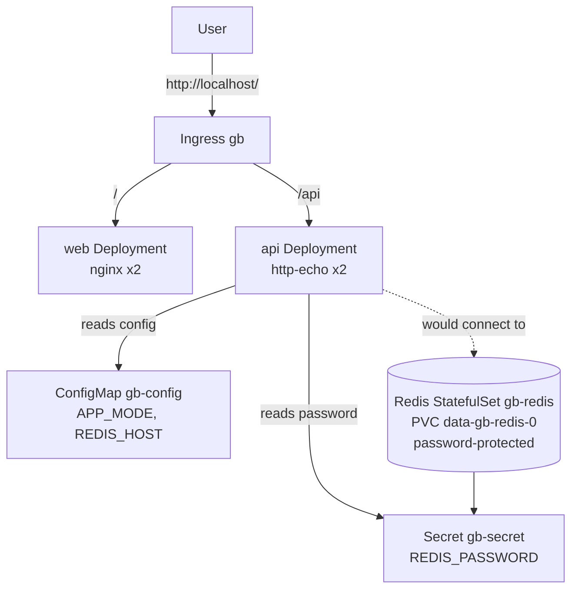

# Capstone — Guestbook: A Multi-Tier App on Kubernetes

Bring everything together. You'll deploy a three-tier application — a **web** frontend, an **API**, and a **Redis** datastore — wired with a ConfigMap, a
Secret, Services, persistent storage, and an Ingress, all packaged as a single **Helm chart**.

## Architecture



## What it exercises (course map)

| Tier / piece | Concepts from sections |
|--------------|------------------------|
| web Deployment + Service   | Pods, Deployments, Services, readiness probes |
| api Deployment + Service   | Deployments, ConfigMap + Secret injection|
| Redis StatefulSet + PVC    | StatefulSets, headless Service, PV/PVC |
| ConfigMap + Secret         | Configuration & sensitive data|
| Ingress                    | HTTP routing (S12) |
| Helm chart                 | Packaging, values, upgrade/rollback |

## Deploy

```bash
# From the course root, with the cluster up and ingress-nginx installed:
helm lint capstone/guestbook
kubectl create namespace course-capstone
helm install gb ./capstone/guestbook -n course-capstone

# Wait for all tiers
kubectl -n course-capstone rollout status deploy/gb-web
kubectl -n course-capstone rollout status deploy/gb-api
kubectl -n course-capstone rollout status statefulset/gb-redis
```

## Verify (all checks pass live)

```bash
# Objects created by the chart
kubectl -n course-capstone get deploy,sts,svc,ingress,cm,secret,pvc

# Redis persistence + auth (password comes from the Secret)
kubectl -n course-capstone exec gb-redis-0 -- redis-cli -a s3cr3t-redis set greeting "hi" 
kubectl -n course-capstone exec gb-redis-0 -- redis-cli -a s3cr3t-redis get greeting   # hi

# Routing through the Ingress
HOST=ingress-nginx-controller.ingress-nginx.svc.cluster.local
kubectl -n course-capstone run c --image=curlimages/curl:8.11.1 --restart=Never -i --rm -- curl -s http://$HOST/      # nginx welcome
kubectl -n course-capstone run c --image=curlimages/curl:8.11.1 --restart=Never -i --rm -- curl -s http://$HOST/api   # API message
# On your host (kind maps 80): curl localhost/  and  curl localhost/api
```

## Upgrade & roll back (Helm)

```bash
helm upgrade gb ./capstone/guestbook -n course-capstone --set api.replicas=3
helm history gb -n course-capstone
helm rollback gb 1 -n course-capstone
```

## Tear down

```bash
helm uninstall gb -n course-capstone
kubectl delete namespace course-capstone
```

See `lesson-01-deploy/` and `lesson-02-helm-package/` for the narrated walkthroughs.
