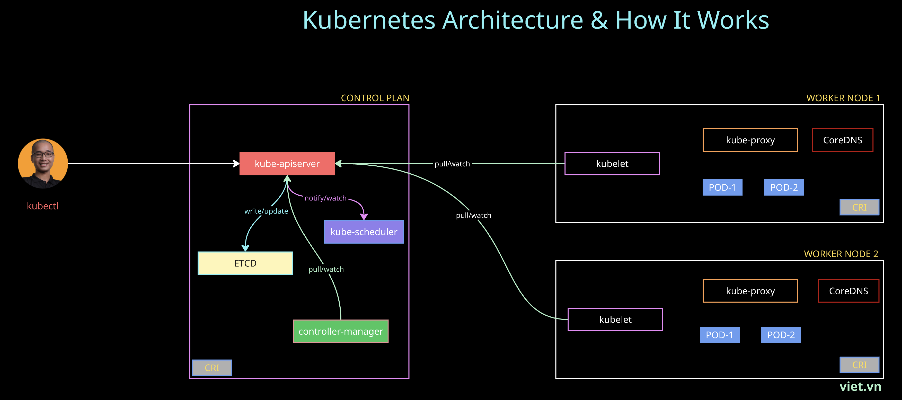
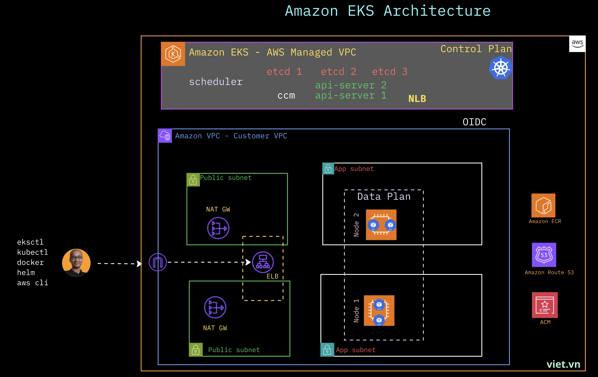

# Amazon EKS: The Complete Hands-on Course

> Go from `kubectl get pods` to running production-grade workloads on **Amazon EKS** — networking, storage, autoscaling, serverless compute, Infrastructure-as-Code, and GitOps. Every lesson is copy-paste runnable, costed, and comes with a cleanup step so you never get a surprise bill.

**100% hands-on. Zero fluff. Real AWS, real clusters, real money-saving habits.**

---

## 🎯 Who this course is for

This course is built for people who ship — or want to ship — containers on AWS at scale:

- **Cloud Engineers** — stand up and operate EKS clusters the right way from day one.
- **DevOps Engineers / SREs** — automate autoscaling, storage, networking, and GitOps delivery.
- **Developers** — understand how your app actually runs, scales, and gets exposed on Kubernetes.
- **Tech Leads** — make informed calls on Fargate vs. EC2, Karpenter vs. Cluster Autoscaler, IRSA vs. Pod Identity.
- **Solution Architects** — design cost-aware, multi-AZ, production-ready EKS architectures.

**Prerequisites:** basic AWS familiarity (IAM, EC2, VPC) and comfort on the command line. **No prior Kubernetes experience required** — Part 1 builds it from scratch.

---

## 🚀 What you'll be able to do by the end

- Build a mental model of Kubernetes — Pods, Deployments, Services, probes, config, storage, scheduling, and RBAC.
- Package and ship applications with **Helm**.
- Create and operate **Amazon EKS** clusters with `eksctl` **and** Terraform.
- Expose workloads with **CLB, NLB, and the AWS Load Balancer Controller (ALB)** — path/host routing, HTTPS with ACM, internal LBs, shared ingress.
- Automate DNS with **ExternalDNS + Route 53**.
- Scale everything: **HPA, VPA, Cluster Autoscaler, and Karpenter**.
- Run **serverless pods on Fargate** with multiple profiles.
- Attach persistent storage with the **EBS, EFS, and instance-store CSI** drivers — including dynamic provisioning, resizing, and RAID-0 NVMe.
- Deliver continuously with **GitOps using Argo CD**.
- Do all of the above with **cost-saving defaults** (Graviton, Spot, scale-to-zero) baked in.



K8S Architecture



Amazon EKS Architecture

---

## 🗺️ Course structure

The repo is split into two parts. Part 1 gives you the Kubernetes foundation locally (fast, free, no cloud bill). Part 2 takes those skills to Amazon EKS on real AWS.

### 📦 Part 1 — Kubernetes Foundations (`PART-1-k8s/`)

Run a local cluster (kind) and master the core primitives before spending a cent on AWS.

| Area | Topics |
|------|--------|
| **Core objects** | Pods, ReplicaSets, Deployments & rollout strategies |
| **Networking** | ClusterIP, NodePort, LoadBalancer, DNS, Endpoints, Ingress |
| **Metadata** | Labels, Selectors, Annotations |
| **Config & secrets** | ConfigMaps, Secrets and how pods consume them |
| **Scheduling** | Node selectors, affinity/anti-affinity, taints & tolerations, DaemonSets |
| **Storage** | Volumes, PV, PVC, StorageClasses, StatefulSets, headless Services |
| **Reliability** | Liveness, readiness & startup probes, resource requests/limits |
| **Autoscaling** | Metrics Server, Horizontal Pod Autoscaler |
| **Packaging** | Helm charts, values, upgrade & rollback |
| **Security** | Namespaces, ServiceAccounts, Roles, ClusterRoles, RBAC |
| **🏆 Capstone** | A 3-tier Guestbook app (web + API + Redis) wired with ConfigMap, Secret, StatefulSet, Ingress — packaged as one Helm chart |

### ☁️ Part 2 — Amazon EKS Hands-on (`PART-2-eks/`)

29 focused, self-contained demos. Each follows the **same README structure** so you always know what it does, what it costs, and how to tear it down.

| # | Topic | Billable? |
|---|-------|-----------|
| 01 | Install AWS CLI, eksctl, kubectl + IAM policies | No |
| 02 | Create EKS cluster + node group (eksctl) | **Yes** |
| 03–05 | Classic LB, Network LB, internal NLB | **Yes** |
| 06 | Install the AWS Load Balancer Controller | **Yes** |
| 07–09 | ALB path routing, HTTPS with ACM, HTTP→HTTPS redirect | **Yes** |
| 10–11 | ExternalDNS + Route 53, auto-assign custom domains | **Yes** |
| 12–16 | Host routing, IngressGroup, one ALB across namespaces, target-type `ip`, internal ALB | **Yes** |
| 17–18 | Fargate profiles (single & multiple) | **Yes** |
| 19–22 | HPA, VPA, Cluster Autoscaler, **Karpenter** (consolidation, drift, expiry) | Mixed |
| 23–27 | EBS CSI (resize, io2, topology, StatefulSets), multi-AZ pods, max-pods math, **EFS** CSI, instance-store NVMe + RAID-0 | **Yes** |
| 28 | Provision EKS with **Terraform** | **Yes** |
| 29 | **GitOps with Argo CD** | **Yes** |

> Every billable demo ends with a **🧹 Cleanup** section. Run it. Load Balancers, NAT, EFS, and large EC2 instances bill by the hour even when idle.

---

## 🧱 Why this course is different

- **Everything runs.** No slideware. Copy-paste commands you can execute against a real cluster.
- **Consistent lesson format.** Every Part-2 demo has: 🎯 Scenario → 🗺️ Architecture → ✅ Prerequisites → 🚀 Steps → 🔍 Validation → 🧹 Cleanup → 📝 Notes & cost.
- **Cost-aware by design.** Graviton (ARM64) instances, Spot capacity, scale-to-zero, single NAT, and an always-present cleanup step.
- **Modern and opinionated.** Karpenter alongside Cluster Autoscaler, EKS Pod Identity noted over IRSA, Terraform alongside eksctl — so you learn the trade-offs, not just one path.
- **Production mindset.** Security notes call out where demo shortcuts (broad IAM, `Resource: "*"`) must become least-privilege in the real world.

---

## ⚙️ Conventions

| Setting | Value |
|---------|-------|
| Region | `ap-southeast-1` (Singapore) |
| AWS CLI profile | `eks` |
| Cluster name | `vietvn` (replace as needed) |
| Demo app image | `vietaws/eks:home`, `vietaws/eks:v1` (public, Docker Hub) |

Replace region, profile, cluster name, account ID, domain, and certificate ARN placeholders with **your own** values.

> 🔐 **Security:** These demos are optimized for learning, not production. Never commit real AWS Account IDs, ACM ARNs, OIDC IDs, or admin passwords. Use placeholders: `ACCOUNT_ID`, `CERT_ARN`, `OIDC_ID`, `<your-domain>`.

---

## 🏁 Getting started

```bash
# 1. Start with Kubernetes foundations (local, free)
cd PART-1-k8s/01-prep
./cluster-up.sh          # spins up a local kind cluster

# 2. When you're ready for the cloud, move to EKS
cd ../../PART-2-eks/01-prep
# follow 00-install.md and 01-policies.md, then 02-create-eks-cluster/
```

Work through Part 1 top-to-bottom to build the foundation, then pick any Part-2 demo — they're self-contained.

---

## 📚 Repo layout

```
eks-course/
├── PART-1-k8s/        # Kubernetes foundations (kind, local)
│   ├── 01-prep/       # cluster-up.sh, kind-config.yaml
│   ├── 00-manifests/  # every YAML used in the lessons
│   ├── 04-Pod.md …    # numbered lesson guides
│   └── capstone/      # 3-tier Guestbook Helm chart
└── PART-2-eks/        # Amazon EKS hands-on demos (01 → 29)
    ├── 01-prep/       # install + IAM policies
    ├── 02-create-eks-cluster/
    └── …              # networking, storage, autoscaling, Fargate, Terraform, Argo CD
```

---

## 🎓 Enroll and start building

If you want to **actually operate EKS** — not just read about it — this course gives you the muscle memory. Clone the repo, spin up a cluster, and ship.

**Happy shipping! 🚢**
